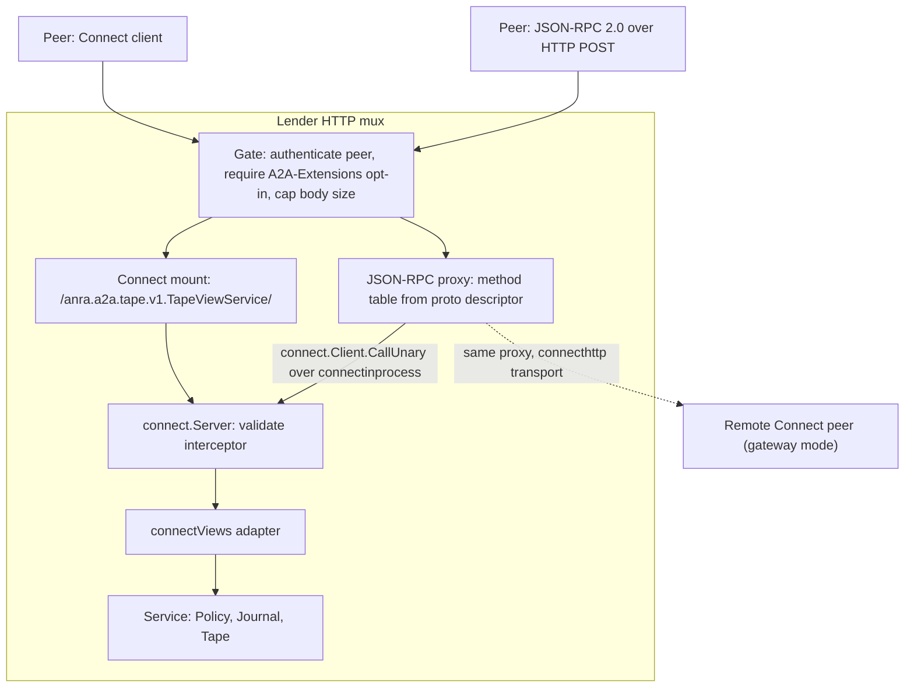

# A2A Tape View JSON-RPC Proxy

Status: proposal. Nothing in this document is implemented.

## Problem

A2A's native binding is JSON-RPC 2.0, and the core endpoint (`/a2a`) speaks it.
The tape-view extension is served only as protobuf/Connect
(`anra.a2a.tape.v1.TapeViewService`), after the handwritten extension JSON-RPC
transport was removed because it duplicated the schema by hand. A peer that
speaks only A2A JSON-RPC therefore cannot borrow context without adding a
Connect client.

The goal is a JSON-RPC 2.0 binding of the *same* service that:

- is derived from `tape.proto`, so adding or changing an RPC needs no
  hand-written transport code;
- reuses the Connect handlers, the `validate` interceptor and the error table,
  so both bindings behave identically;
- adds no authority of its own: identity, extension opt-in and size limits come
  from the same gate as the Connect endpoint.

Non-goals: JSON-RPC batches, streaming methods, replacing the Connect endpoint,
and changing `Service`, `Journal` or `tape.proto`.

## Decision

A single `http.Handler`, the *proxy*, translates a JSON-RPC request into a
unary Connect call and the Connect response back into a JSON-RPC response. It
holds no per-method code. At construction it reads the service descriptor
(`tapev1.File_anra_a2a_tape_v1_tape_proto.Services().ByName("TapeViewService")`)
and builds a table from JSON-RPC method name to method descriptor. A request
then runs as:

```go
client := connect.NewClient(transport)
err := client.CallUnary(ctx, connect.Spec{
    StreamType: connect.StreamTypeUnary,
    Schema:     method,            // protoreflect.MethodDescriptor
    Procedure:  "/" + procedure,   // /anra.a2a.tape.v1.TapeViewService/Borrow
}, req, res)                       // concrete types from protoregistry
```

The `connect.Transport` decides where the call goes:

| Transport | Use | Notes |
| --- | --- | --- |
| `connectinprocess.New(server)` | Lender mounts the proxy next to the Connect endpoint (default) | Dispatches to the same `connect.Server`, so the `validate` interceptor and `connectViews` run unchanged; the call context, and thus the peer identity, reaches the handler |
| `connecthttp.NewTransport(...)` | Standalone gateway in front of a remote Connect peer | The proxy forwards only `Authorization` and `A2A-Extensions` as call request headers (`connect.NewClientContext`); the upstream still authenticates |

Both are the same proxy type; only the transport differs.



## Wire contract

Endpoint: `POST /tape-views`, `Content-Type: application/json`. The Agent Card
extension params gain `jsonrpcEndpoint` beside the existing Connect `endpoint`;
a client prefers Connect when it supports it.

**Method name.** The Connect procedure without the leading slash, for example
`anra.a2a.tape.v1.TapeViewService/Borrow`. It needs no annotation in the proto
and cannot collide with core A2A names. The cost is verbose names; see
[Alternatives](#alternatives-considered).

**Params.** A JSON object holding the request message in the standard protobuf
JSON mapping (`lowerCamelCase`; `int64` and sequences as strings; `bytes` as
base64), the same shape Connect's JSON codec uses. Absent `params` means the
empty message. Array params, unknown fields and a missing `id` are rejected.
Parsing uses `protojson` into the registered Go type of the method's input, so
protovalidate rules apply exactly as for Connect.

**Result.** The response message in the same mapping. Because the proto wraps
responses (`BorrowResponse{decision}`, `ReadResponse{page}`), results are
`{"decision": {...}}` and `{"page": {...}}`. The wire shape of the former
handwritten transport is not preserved.

```json
{"jsonrpc":"2.0","id":1,"method":"anra.a2a.tape.v1.TapeViewService/Borrow",
 "params":{"requestId":"r1","purpose":"answer","query":"locking"}}
```

```json
{"jsonrpc":"2.0","id":1,"result":{"decision":{"requestId":"r1",
 "status":"DECISION_STATUS_GRANTED","view":{"viewId":"..."}}}}
```

**Not supported.** A batch (JSON array) returns `-32600`. A request without
`id` (a notification) returns `-32600` rather than executing silently, because
`Borrow` and `Release` have side effects. Unknown methods return `-32601`.

## Errors

There is one error mapping: sentinel error to Connect code, as in `errors.go`
today. The proxy derives the JSON-RPC code from the Connect error it receives;
it never inspects sentinels, so the two bindings cannot drift. Anra's codes are
in `-32050..-32099`, clear of both JSON-RPC's reserved range and A2A's own
`-32001..-32009`.

| Sentinel | Connect code | JSON-RPC code |
| --- | --- | --- |
| `ErrInvalidParams` or validation failure | `invalid_argument` | `-32602` |
| `ErrUnavailable` | `not_found` | `-32050` |
| `ErrConflict` | `already_exists` | `-32051` |
| `ErrInactive` | `failed_precondition` | `-32052` |
| `ErrUnsupported` | `unimplemented` | `-32053` |
| `context.DeadlineExceeded` | `deadline_exceeded` | `-32054` |
| `context.Canceled` | `canceled` | `-32055` |
| `ErrStorage`, anything else | `internal` | `-32603` |

`error.message` is the Connect message, which is already free of storage and
policy detail. `error.data` is `{"code": "<connect code>"}` so a JSON-RPC client
can recover the category without matching message text, which
`fromConnectError` currently has to do.

HTTP status is `200` for every JSON-RPC error, as usual for JSON-RPC over HTTP.
The gate answers before any JSON is read: `401` for failed authentication, the
same as `/a2a`, and `413` over `MaxBodyBytes`. A missing extension opt-in
returns HTTP `400` with a JSON-RPC `-32052` error and `id: null`.

## Gate and component changes

1. Extract the authentication and `A2A-Extensions` check in `NewViewHandler`
   into one gate used by both bindings. It stays the single place that sets
   the peer in the context (`peerKey`), so no params field can supply identity.
2. Add `pkg/a2a/jsonrpc.go`: `NewJSONRPCProxy(transport, service, opts...)`.
   Construction fails if a method is not unary or its message types are not in
   `protoregistry.GlobalTypes`.
3. `NewViewHandler` builds the `connect.Server` once and gives the in-process
   transport to the proxy, so both bindings share interceptors.
4. `NewPeerHandler` mounts the proxy at `/tape-views`; `Advertise` adds
   `jsonrpcEndpoint` to the card params.
5. A single table in `errors.go` gains the JSON-RPC code column; `connectError`
   and the proxy both read it.

Every unary RPC in the service becomes callable over JSON-RPC. That is the
intent, and the proto remains the single place that decides what is remotely
callable: lender-local operations (`Resolve`, `Revoke`) are not in the proto and
stay unreachable.

## Invariants and failure behavior

- Identity comes only from the gate. Params, `id` and headers other than the
  forwarded credential never affect who the requester is.
- A request is validated once, by the same `validate` interceptor, whichever
  binding delivered it.
- The proxy keeps no state. Retrying a `Borrow` with the same `requestId` is
  idempotent through the journal, exactly as over Connect.
- Unknown methods and malformed JSON fail closed before reaching the service.
- Gateway mode forwards credentials but trusts nothing from the upstream beyond
  the Connect error code and message; it does not widen what the upstream grants.

## Compatibility

The Connect endpoint, `tape.proto`, `Service` and the journal are unchanged.
The extension URI stays `urn:anra:a2a:tape-view:v1`; `jsonrpcEndpoint` is an
additive card param that existing clients ignore. Method names and result
shapes are new: no deployed JSON-RPC client exists, because the earlier
transport was removed before release.

## Client side (follow-up)

The symmetric piece is a `connect.Transport` that carries `Spec.Procedure` as
the JSON-RPC method over HTTP. The generated `TapeViewServiceClient` and
`BorrowTool` would then work over JSON-RPC unchanged. It is not needed to serve
JSON-RPC peers, so this proposal leaves it out; the E2E scenarios below call the
endpoint with plain HTTP.

## Acceptance

BDD scenarios in `tests/e2e/features/peers.feature`, through real HTTP and the
existing temporary-disk fixtures:

- A borrower borrows, reads every page and releases over JSON-RPC and gets the
  same decision and entries as over Connect.
- Retrying a request ID over JSON-RPC returns the same grant; a different body
  with the same ID returns `-32051`.
- Unauthenticated calls return `401`; calls without the extension header return
  `-32052`.
- Invalid params, an unknown method, a batch and a notification return
  `-32602`, `-32601`, `-32600` and `-32600`.
- An unauthorized view ID returns `-32050` and reveals nothing about another
  requester's grant.

## Alternatives considered

- **Hand-written JSON-RPC methods.** What was removed: one decoder, encoder and
  error mapping per method that drifts from the proto.
- **HTTP loopback to the Connect JSON endpoint.** Works without descriptors but
  adds a network hop, re-runs authentication and loses typed errors.
- **`connectrpc.com/vanguard`.** Transcodes among Connect, gRPC and REST, and
  does not speak JSON-RPC.
- **A `jsonrpc_method` proto option for short names** such as `tape/views/borrow`.
  Nicer names, but it edits the proto and regenerates code, and every new RPC
  needs an annotation. Easy to add later without changing the proxy design:
  the method table would read the option and fall back to the procedure name.

## Open questions

1. Are the verbose procedure names acceptable on the wire, or do you want the
   short-name option from the last alternative?
2. Should gateway mode (`connecthttp` transport) ship now, or only the
   in-process mode, leaving gateway for when a real deployment needs it?
3. Should the JSON-RPC client transport be part of the first implementation?
